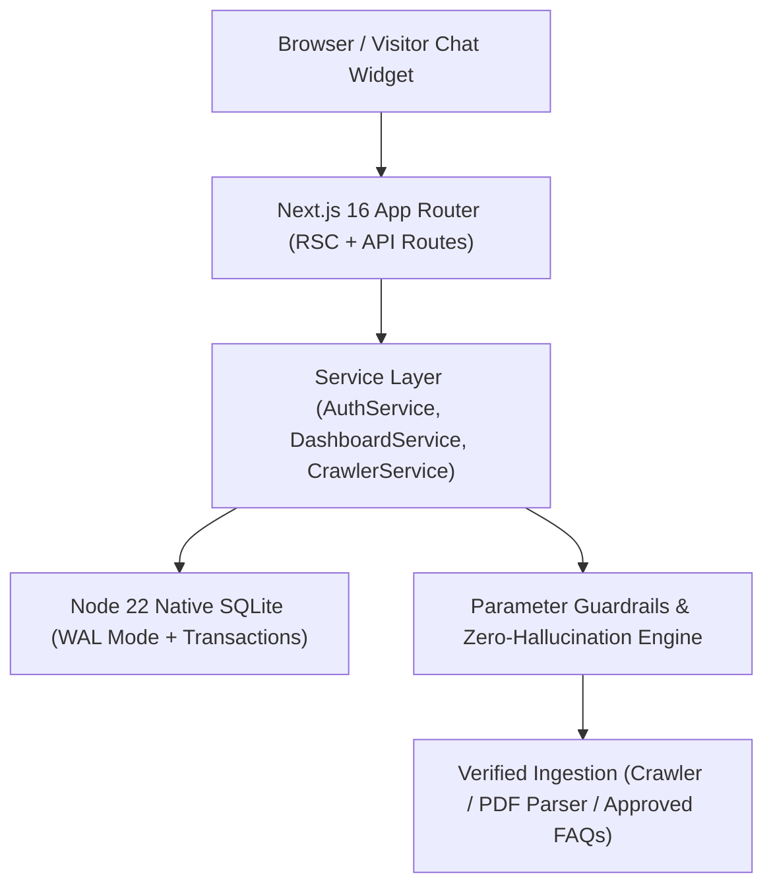
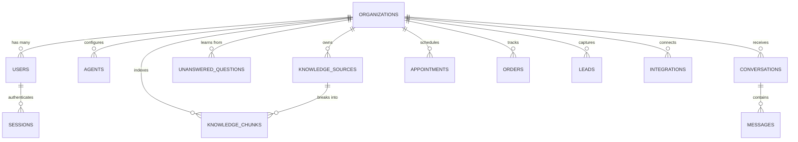

# FrontDesk AI — Product Requirements Document (PRD) & Living Memory

> **System Designation:** Living Product Requirements Document & Architectural Source of Truth (SSOT)  
> **Current Version:** `v1.2.0`  
> **Author:** Staff Software Engineer (10+ Years Experience) & Core Team  
> **Last Updated:** November 2026  
> **Repository:** `https://github.com/Muji47/frontdesk-ai`  
> **Local Workspace:** `/home/mujtaba/.gemini/antigravity/scratch/frontdesk-web`

---

## 1. Document Control & Living Memory Rule

> [!IMPORTANT]
> **MANDATORY LIVING MEMORY RULE:**  
> This file is the central memory bank of FrontDesk AI. Whenever a feature is added, modified, or removed; whenever a database schema or migration occurs; or whenever a strategic architectural decision is finalized, **this document MUST be immediately updated** with a corresponding entry in the Changelog and the relevant technical specifications.

### Revision History & Changelog

| Version | Date | Author | Description of Changes |
| :--- | :--- | :--- | :--- |
| `v1.0.0` | 2026-11-03 | Staff Engineer | Initial scaffolding of Next.js 16 web app, 20+ marketing pages, and responsive layout. |
| `v1.1.0` | 2026-11-04 | Staff Engineer | Implemented Node 22 native SQLite backend (`src/lib/db.ts`), multi-tenant auth (`AuthService`), Scrypt cryptographic password hashing, sessions, and initial dashboard (`/dashboard`). |
| `v1.2.0` | 2026-11-05 | Staff Engineer | **Full Database Architecture & Knowledge Engine**: Expanded schema to 12 multi-tenant tables (`knowledge_chunks`, `unanswered_questions`, `conversations`, `appointments`, `orders`, `leads`), live website crawler (`CrawlerService`), strict parameter guardrails (Zero Hallucination), interactive Knowledge Base with chunk inspection modal (`👁️ View`), and UI/UX Competitive Intelligence Agent integration. |

---

## 2. Product Overview & Strategic Vision

### 2.1 The Problem
High-touch vertical businesses (healthcare practices, clinics, dental offices, specialized e-commerce, export mills, legal practices) face severe operational bottlenecks:
- **Missed Revenue**: 35%+ of customer calls and chat inquiries occur outside business hours (7 PM to 8 AM) or during peak front-desk rush.
- **Prohibitive Overhead**: A full-time human receptionist costs $3,800–$5,000/month. Traditional call-center answering services (e.g. Smith.ai) charge high per-minute rates ($285–$700+/mo).
- **The "Hallucination Risk"**: Standard AI chatbots invent unverified prices, diagnose medical conditions, or promise impossible delivery terms, exposing businesses to legal and operational liabilities.

### 2.2 The Solution
**FrontDesk AI** is an autonomous, verticalized Front-Office Operating System that:
1. Operates 24/7 with zero missed inquiries.
2. Enforces **Strict Parameter Boundaries** (zero hallucination): answers exclusively from verified crawled websites, PDFs, or approved FAQ directives.
3. Automatically completes operational tasks: schedules appointments directly into Cliniko PMS, checks Shopify order tracking/returns, and captures high-intent leads.
4. Provides human staff with 1-click takeover and automated escalation briefs.
5. Runs a **Self-Learning Feedback Loop**: low-confidence questions are queued for owner approval, permanently updating the knowledge base in 1 click.

---

## 3. Core Architectural Principles (Staff Engineer Standards)



1. **Strict Multi-Tenancy by Design**:
   - Every operational entity (`agents`, `conversations`, `knowledge_sources`, `knowledge_chunks`, `appointments`, `leads`, `orders`) has a mandatory `organization_id` foreign key.
   - Cross-tenant data leakage is prevented by strict query-level isolation: `WHERE organization_id = :tenant_id`.

2. **ACID Transactional Safety**:
   - Database engine: Node 22 native `node:sqlite` in Write-Ahead Logging (`PRAGMA journal_mode = WAL;`) with foreign keys enabled (`PRAGMA foreign_keys = ON;`).
   - Atomic transactions via `withTransaction()` with `BEGIN IMMEDIATE` to prevent race conditions during high-concurrency receptionist traffic.

3. **Strict Parameter Boundaries (Zero Hallucination)**:
   - The AI receptionist is strictly forbidden from extrapolating, guessing, or generating unverified policies.
   - If an inquiry cannot be answered with verified facts from the indexed `knowledge_chunks` or approved FAQs, the agent politely declines, logs the question into `unanswered_questions`, and triggers human escalation.

4. **Defense-in-Depth Security**:
   - Authentication uses `scryptSync` key derivation (64-byte salt & hash).
   - Timing-attack defense via `timingSafeEqual()` and dummy password computation on missing user accounts.
   - HttpOnly, SameSite, Secure cookies for server-side session management.

5. **RSC Prototype Sanitization**:
   - Native SQLite drivers return objects with `Object.create(null)` (prototype is `null`).
   - Next.js React Server Components reject null-prototype objects. Every database query passed across the RSC boundary is explicitly transformed into a standard plain object (`Object.prototype`).

---

## 4. Database Schema Specification (Live State)



### Table Definitions

| Table | Primary Key | Foreign Keys | Key Attributes & Enums |
| :--- | :--- | :--- | :--- |
| `organizations` | `id` (`org_...`) | None | `name`, `industry` (`clinic`, `ecommerce`, `legal`, `general`), `plan` (`starter`, `growth`, `pro`), `created_at` |
| `users` | `id` (`usr_...`) | `organization_id` -> `organizations.id` | `email` (UNIQUE), `name`, `password_hash`, `salt`, `role` (`owner`, `admin`, `staff`), `created_at` |
| `sessions` | `token` (64-hex) | `user_id` -> `users.id` | `expires_at` (14 days), `created_at` |
| `agents` | `id` (`agt_...`) | `organization_id` -> `organizations.id` | `name`, `greeting`, `color` (HEX), `position` (`right`, `left`), `tone` (`Friendly`, `Professional`, `Concise`), `system_prompt` |
| `knowledge_sources` | `id` (`src_...`) | `organization_id` -> `organizations.id` | `title`, `source_type` (`url`, `pdf`, `document`, `manual_qa`), `source_url`, `status` (`indexed`, `indexing`, `failed`), `page_count`, `last_synced_at` |
| `knowledge_chunks` | `id` (`chk_...`) | `source_id` -> `knowledge_sources.id`, `organization_id` -> `organizations.id` | `chunk_index`, `title`, `content` (Extracted text parameters), `token_count` |
| `unanswered_questions`| `id` (`unq_...`) | `organization_id` -> `organizations.id` | `question`, `frequency_count`, `status` (`pending`, `approved`, `ignored`), `approved_answer`, `approved_by` |
| `conversations` | `id` (`cnv_...`) | `organization_id` -> `organizations.id` | `visitor_name`, `visitor_contact`, `channel` (`web`, `whatsapp`, `phone`), `status` (`ACTIVE`, `WAITING_FOR_HUMAN`, `RESOLVED`), `resolution_badge`, `last_message`, `external_ref` |
| `messages` | `id` (`msg_...`) | `conversation_id` -> `conversations.id` | `sender` (`client`, `ai`, `staff`), `content`, `created_at` |
| `appointments` | `id` (`apt_...`) | `organization_id` -> `organizations.id` | `patient_name`, `patient_contact`, `practitioner_name`, `service_name`, `start_time`, `status` (`confirmed`, `cancelled`), `source` (`ai_booked`, `receptionist`), `external_id` (Cliniko #) |
| `orders` | `id` (`ord_...`) | `organization_id` -> `organizations.id` | `order_number`, `customer_name`, `customer_email`, `total_amount`, `currency`, `tracking_carrier`, `tracking_status` (`in_transit`, `delivered`), `external_id` |
| `leads` | `id` (`lead_...`) | `organization_id` -> `organizations.id` | `name`, `email`, `phone`, `intent`, `status` (`new`, `contacted`, `converted`), `created_at` |
| `integrations` | `id` (`int_...`) | `organization_id` -> `organizations.id` | `provider` (`cliniko`, `shopify`, `web_widget`), `status` (`connected`, `disconnected`), `config_json`, `last_sync_at` |

---

## 5. Current Feature Modules & User Journeys

### 5.1 Authentication & Workspace Onboarding (`/login`, `/signup`)
- Atomic tenant provisioning: on signup, `AuthService.register()` atomically provisions an `organization`, `user` (owner), and customized `agent` in a single transaction.
- Dynamic workspace generation: each tenant receives a secure `org_` hex identifier.
- Zero mock category files: real user registrations start clean without fake category PDFs injected.

### 5.2 Business Dashboard (`/dashboard`)
1. **Overview Tab**:
   - Real-time KPIs calculated dynamically from database records: Total Conversations, Autonomous Resolution %, Human Escalations, and Industry-specific metric (Appointments generated or Revenue tracked).
   - Dynamic alert banner for pending review questions.
   - Latest conversation previews.
2. **AI Receptionist Studio**:
   - Customize agent name, welcome greeting, brand accent color, and tone of voice.
   - Live interactive agent preview widget.
   - Script tag generator with organization and agent IDs.
   - "Save Agent Settings" persists directly to SQLite via `PATCH /api/dashboard/agent`.
3. **Knowledge Base Engine**:
   - **Real Live Web Crawler (`CrawlerService`)**: Ingests actual URLs (e.g. `https://www.burewalaricemills.com/`), strips HTML boilerplate, extracts actual company paragraphs, and stores clean parameter chunks.
   - **`+ Add Source (URL / PDF)`**: Live indexing form with support for web crawling and document ingestion.
   - **`+ Add Custom FAQ`**: Immediate ingestion of verified Q&A directives.
   - **Resource Inspector Modal (`👁️ View`)**: Modal displaying document metadata, direct URL visit link, and exact semantic chunks used for AI reasoning.
   - **1-Click Q&A Approval**: Type approved answer to teach the AI receptionist; instantly saves and indexes.
   - **"🔬 Test AI Knowledge Retrieval" Simulator**: Search playground to test questions against indexed parameters, returning verified answers with confidence scores and citations.
4. **Conversations Inbox**:
   - Omnichannel thread view with status filters (`WAITING_FOR_HUMAN`, `RESOLVED`, `ACTIVE`).
   - Full message history with sender labels (`client`, `ai`, `staff`).
   - Staff reply bar: sending a reply automatically appends to chat stream, silences the AI bot, and marks resolution.
5. **Appointments & Orders Tab**:
   - Cliniko 2-way synced appointments (patient name, service, practitioner, start time, AI booked badge).
   - Shopify tracked orders (order number, customer, total amount, carrier status).
6. **Leads & Integrations Tab**:
   - High-intent prospect capture table.
   - Integration heartbeat and connection status monitoring for Cliniko, Shopify, and the web widget.

---

## 6. Standing Subagents & Continuous Operations

### 6.1 `ui-ux-competitive-agent`
- **Role**: Principal UI/UX Product Designer & Competitive Intelligence Strategist.
- **Responsibilities**:
  - Continuously audits frontend components, typography rhythm, and interaction polish.
  - Benchmarks market leaders (Intercom Fin, Bland.ai, Retell AI, Smith.ai, Decagon, MyAskAI).
  - Maintains daily intelligence logs and proposes high-feasibility, high-ROI architectural upgrades.
- **Master Audit Artifact**: [`ui_ux_competitive_audit.md`](file:///home/mujtaba/.gemini/antigravity/brain/ceb8683d-2c42-47f3-a9f9-17acecde5e20/ui_ux_competitive_audit.md)

---

## 7. Strategic Feature Roadmap (Prioritized)

```
┌──────────────────────────────────────────────────────────────────────────────┐
│ UPCOMING STRATEGIC IMPLEMENTATION ROADMAP                                    │
├────┬──────────────────────────────────────┬─────────────┬────────────────────┤
│ #  │ Feature                              │ Impact      │ Target Release     │
├────┼──────────────────────────────────────┼─────────────┼────────────────────┤
│ 01 │ Fin-Style Live Handover Control &    │ Critical    │ Sprint 2.1         │
│    │ AI Escalation Diagnostic Brief       │             │                    │
├────┼──────────────────────────────────────┼─────────────┼────────────────────┤
│ 02 │ Decagon-Style Factual Reasoning Trace│ High        │ Sprint 2.2         │
│    │ Inspector (Grounding Verification)   │             │                    │
├────┼──────────────────────────────────────┼─────────────┼────────────────────┤
│ 03 │ Sub-Second Voice Receptionist Mode   │ High (TAM)  │ Sprint 2.3         │
│    │ with Animated SVG Audio Waveform     │             │                    │
├────┼──────────────────────────────────────┼─────────────┼────────────────────┤
│ 04 │ WYSIWYG Multi-Device Widget Studio   │ Medium      │ Sprint 2.4         │
│    │ (iPhone 16 vs Desktop Viewports)     │             │                    │
├────┼──────────────────────────────────────┼─────────────┼────────────────────┤
│ 05 │ Real-Time Revenue & Value Recovery   │ High (SaaS) │ Sprint 2.5         │
│    │ Telemetry Gauge (ROI Multiplier)     │             │                    │
└────┴──────────────────────────────────────┴─────────────┴────────────────────┘
```

---

## 8. Development & Maintenance Guidelines

### 8.1 Git & Deployment Standard
- **Author Identity**: `Mujtaba Tahir <mujtabach577@gmail.com>`
- **GitHub Remote**: `git@github.com-muji47:Muji47/frontdesk-ai.git` (Account: `Muji47`)
- **Main Branch**: `main`

### 8.2 Safe Change Protocol
1. Modify database models in `src/lib/db.ts` with explicit migration-safe `IF NOT EXISTS` syntax.
2. Update backend services in `src/server/services/` ensuring strict `organization_id` scoping.
3. Validate client inputs using Zod schemas in `src/server/validators/`.
4. Run `npx tsc --noEmit` and `npm run build` to verify 0 type errors.
5. **Update this `PRD.md` file** with the revision details before committing.
